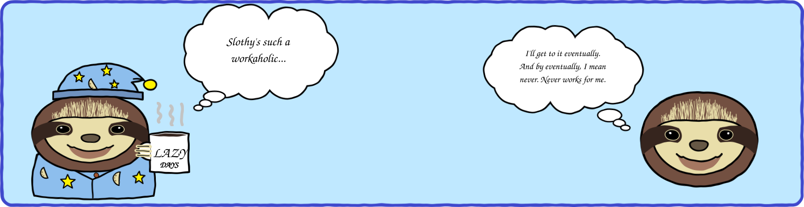

### 👋 Ciao, I'm Marko!

😎 Software Engineer from Novi Sad, Serbia | Building systems that matter

🌍 Fluent in English and Greek, semi-fluent in German, and native in South Slavic languages.

&nbsp;

## 🚀 Projects

<table style="border-radius: 10px; overflow: hidden;">
<tr>
<td colspan="2" valign="top" style="padding: 20px; border: 1px solid #e1e4e8; border-radius: 10px;">

### 🍬 [sweet-search](https://github.com/mrsladoje/sweet-search) 
Local code search for AI coding agents.

`5–33% cheaper agent runs` `SOTA code retrieval`   `100% local` `Hybrid search` `Code graph`

</td>
</tr>
<tr>
<td width="50%" valign="top" style="padding: 20px; border: 1px solid #e1e4e8; border-radius: 10px;">

### 🐕 [HundDB](https://github.com/mrsladoje/HundDB)
High performance LSM-tree database built from scratch in Go. Complete with WAL, memtables, SSTables, compaction strategies, and a gorgeous desktop UI.

`Go` `Wails` `React` `LSM` &nbsp;[📺 Demo](https://www.youtube.com/watch?v=gkG7mmT554E)

</td>
<td width="50%" valign="top" style="padding: 20px; border: 1px solid #e1e4e8; border-radius: 10px;">

### 🕊️ [Peaceful Protest Tracker](https://github.com/mrsladoje/hackupc2025)
🏆 **2nd Place @ HackUPC 2025** – Real-time dashboard exposing media bias in Serbian protest coverage using AI sentiment analysis and visualization.

`Spring Boot` `Python` `Grafana` &nbsp;&nbsp;[🌐 Live](https://protests.grafana.net/public-dashboards/b2a775b17b8b47b49a215a161b0c9a91) &nbsp;[📺 Demo](https://www.youtube.com/watch?v=Eguzdn9z5Ac)

</td>
</tr>
<tr>
<td width="50%" valign="top" style="padding: 20px; border: 1px solid #e1e4e8; border-radius: 10px;">

### 🪑 [Interia](https://github.com/deepgrad/epiplar.io)
🏆 **1st Place + 10k grant @ Garaza 2025** – Transform any room with AI-powered 3D reconstruction and intelligent furniture replacement.

`Computer Vision` `DA3` `Diffusion` `YoloV8` &nbsp;[📺 Demo](https://www.youtube.com/watch?v=hBA3fvoU_DI)

</td>
<td width="50%" valign="top" style="padding: 20px; border: 1px solid #e1e4e8; border-radius: 10px;">

### 🤖 [Robot in Knossos](https://github.com/mrsladoje/knossos)
Interactive maze game with Prim-based labyrinth generation, ANSI-optimized rendering, and mythological flair. Navigate the halls, avoid the Minotaur!

`C++` &nbsp;*Console-based adventure*

</td>
</tr>
<tr>
<td width="50%" valign="top" style="padding: 20px; border: 1px solid #e1e4e8; border-radius: 10px;">

### 👁 [Vid2sim](https://github.com/Vector-Space-Moggers/vid2sim)
🏆 **1st Place @ DragonHack 2026** – First in the world video to 3d physics playground pipeline.

`Computer Vision` `Stable-Fast-3D` &nbsp;[📺 Demo](https://www.youtube.com/watch?v=7ID7KJoDnME)

</td>
<td width="50%" valign="top" style="padding: 20px; border: 1px solid #e1e4e8; border-radius: 10px;">

### 🖨️ [Apollo](https://github.com/mrsladoje/apollo)
A physics-grounded, agent-driven **digital twin** for HP Metal Jet S100 3D printer.

`PINN` `degradation-modelling` &nbsp;[📺 Demo](https://www.youtube.com/watch?v=7_xYjXKY2TQ)

</td>
</tr>
<tr>
<td width="50%" valign="top" style="padding: 20px; border: 1px solid #e1e4e8; border-radius: 10px;">

### ⚪⚫ [CheckersBot](https://github.com/mrsladoje/CheckersBot)
Checkers bot powered by Minimax with alpha-beta pruning.

`Python` `PyGame`

</td>
<td width="50%" valign="top" style="padding: 20px; border: 1px solid #e1e4e8; border-radius: 10px;">

### 🛠️ [2valves](https://github.com/mrsladoje/2valves)
Parallel media scraper using Intel TBB that pumps truth from two realities — comparing regime vs. independent Serbian media coverage.

`C++` `Flask` `Svelte` &nbsp;[📺 Demo](https://www.youtube.com/watch?v=4mTsmEurYD4)

</td>
</tr>
</table>

&nbsp;

## 🛠️ Tech Stack

**Languages**  

**Backend**  

**Frontend**  

**Data & Search**  

**ML**  

**Infrastructure & Observability**  

**AI Tooling**  

**Specialties:** System Architecture • System Optimization • Best-practice Spring • Neobrutalistic Design • Agentic Coding

&nbsp;

## 🦥 Fun Fact

There are **two groups of sloths** in the world—two-toed and three-toed—differentiated by their front claws. Six species exist across Central and South America, with some critically endangered. 

The slowest revolution is often the most powerful. Stay tuned. 

### 🤫 Something BIG is coming... soon... 🦥✨
